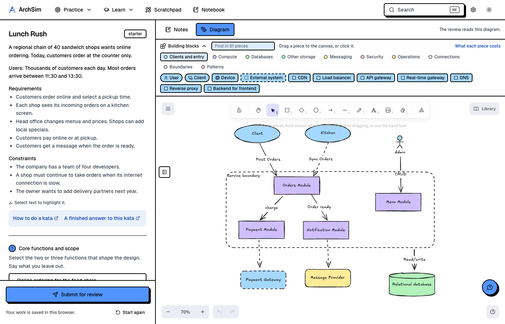
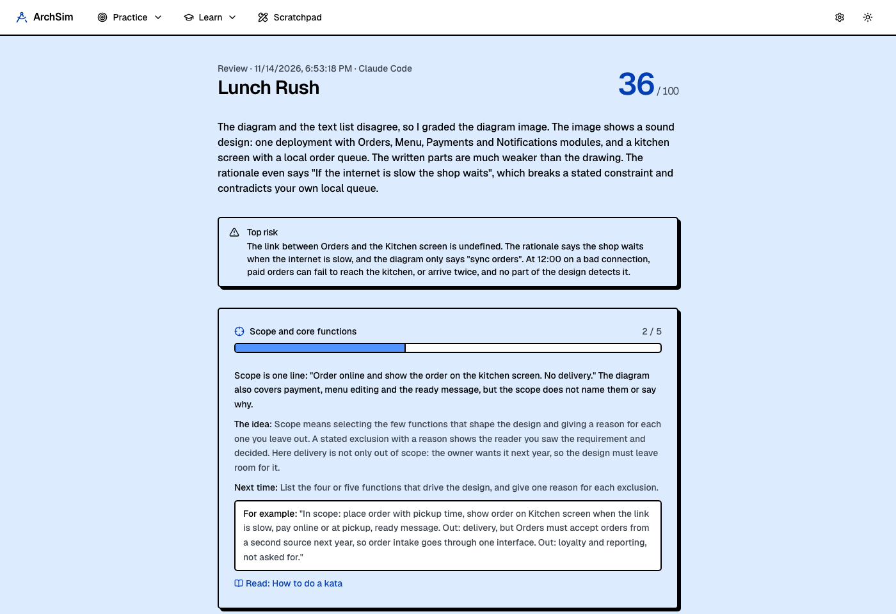
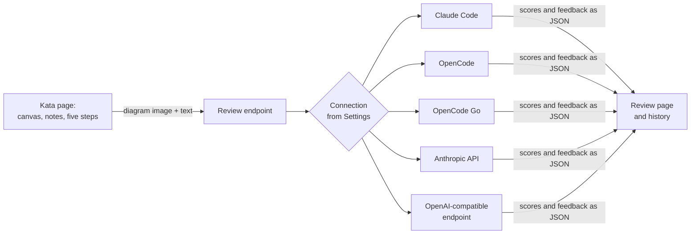

# ArchSim

**Challenge your software architecture knowledge, with an AI reviewer that grades your reasoning.**

Website: [aesbetancourt.dev/archsim](https://aesbetancourt.dev/archsim/)

AI tools now write a large part of the code. The decisions that stay with people are the expensive ones: how a system is divided, where its data lives, how its parts talk, and which qualities it must have. Those decisions are architecture, and they are hard to practice. You can attempt a design alone, but nobody tells you where your reasoning is weak.

ArchSim closes that gap. You take a short business problem, draw a design, explain your trade-offs, and get a structured review in about a minute.


## What you do in it

1. **Pick a kata.** A kata is a short problem: a sandwich chain that wants online orders, a ticket seller that must survive two million buyers, a payment system that must never charge twice.
2. **Think.** Highlight the sentences that matter and write in a private notepad, as you would with pen and paper.
3. **Follow five steps.**
   1. Set the scope. Name the few functions that shape the design, and what you leave out.
   2. Select the characteristics. Pick the qualities that drive this problem, usually three, and tie each one to the text.
   3. Select a style. Choose the simplest architecture style that supports them.
   4. Draw the diagram.
   5. State the trade-offs. Say what your design gives up, and where it fails first.
4. **Get a review.** The reviewer reads your diagram and your text. It scores seven dimensions from 1 to 5 and quotes the evidence for each score from your own work. For each dimension it explains the idea, gives an example, and points to a lesson to read. It also names the top risk and asks the questions a review board would ask.

There is no single correct answer to a kata. The reviewer grades the quality of your reasoning against the problem, not a match with a reference design.





## Features

### Practice

- **Katas and interview questions.** Five original katas from starter to hard, and 16 interview questions. They include the classic system design questions (link shortener, chat, news feed, video streaming, notifications, payments) and open interview prompts.
- **A drawing canvas.** An embedded [Excalidraw](https://excalidraw.com) canvas, the same kind of tool used in real interviews.
- **Building blocks.** A palette above the canvas with 48 standard components in seven groups, three kinds of connection, five boundaries, and five small patterns. Stored data is a cylinder and a message channel is a pipe, as in the usual notation. Drag a piece to the canvas. A Learn page says what each piece costs you.
- **Auto-save.** Your answers, notes, and diagram for each kata are saved in the browser as you work. The home page lists the katas in progress. Kata highlights go to the notebook.
- **A tutor chat.** A help chat sits next to the canvas. In a kata it explains concepts, gives hints, and asks about the pieces you used. It does not hand you the design.
- **Solve a problem.** Paste any problem text, for example an interview question you had. The app writes a worked answer with the five-step method and adds the problem to your katas.
- **The Architectural Katas collection.** The app reads Ted Neward's public kata collection, so you can practice on about 40 more problems.
- **Scratchpad.** Free boards for designs that are not katas. Each board has the full canvas with the building blocks and the same notepad as a kata, and it is saved automatically.


### Learn

- **87 lessons in nine sections** on the knowledge areas of a senior architect: trade-off analysis, characteristics, structure and styles, data and consistency, communication, reliability and operations, and the work with teams. Each lesson has a level, a reading time, and objectives.
- **Design inside one application.** Hexagonal, clean, and onion architecture, vertical slices, domain model patterns, CQRS, and event sourcing, with a clear line between system architecture and application architecture.
- **22 system design cases**, each a short case study of a known type of system.
- **Walkthroughs.** Some lessons explain one diagram in steps, for example a cache that fails and a saga that compensates. Use the buttons or the arrow keys.
- **Worked examples.** Ten finished katas that show each decision and the sentence in the problem that caused it, with a diagram, the rejected options, and a different valid answer.
- **Cheatsheets.** One page for each section, with a filter.
- **A glossary** of 306 terms in plain words, each with an example and a link to a lesson and to Wikipedia.

### Study

- **Search.** Press Cmd+K or Ctrl+K on any page. It finds lessons, sections, cases, katas, terms, cheatsheets, interview questions, and your notes.
- **Highlights and the notebook.** Select text in a lesson to highlight it and add a note. A sidebar holds the notes for each page. The Notebook page collects all highlights, page notes, and general notes.
- **Progress.** Mark a lesson as done. The sidebar shows how many lessons are done in each section.
- **Read aloud.** A player reads the lesson and highlights the sentence that it reads, so your eyes can follow the voice. Press Alt+R to start or pause, or Alt+click a sentence to start there. You can change the speed from 0.75× to 2×. The player uses the voices of your browser, or Google Cloud voices that you select in Settings (see [Read aloud with Google voices](#read-aloud-with-google-voices)).


### Interview practice

- **Question drill.** 410 interview questions from 82 lessons, 28 of them behavioral. Write your answer, and the model grades it against the lesson. Filter by section or by the lessons you finished.
- **Vocabulary drill.** Explain the glossary terms in your own words. Spaced repetition brings back the terms you missed. An optional AI check says what your explanation covers and what it misses.
- **Behavioral interviews and the story bank.** A lesson on behavioral interviews, and a story bank in the notebook. Write true work stories in the STAR form and tag each one with competencies. The bank shows which of the 11 competencies have no story yet. In the drill, a behavioral answer can start from a saved story, and the model grades it as a story.


## Works with several AI providers

The reviewer, the tutor chat, and the worked answers all use one connection that you select in Settings. No provider is required by the design.

| Mode                       | What it uses                                                                                  | API key in the app           |
| -------------------------- | --------------------------------------------------------------------------------------------- | ---------------------------- |
| Claude Code                | The `claude` command and its login on your computer                                           | No                           |
| OpenCode                   | The `opencode` command and its login on your computer                                         | No                           |
| OpenCode Go                | An OpenCode Go API key                                                                        | Yes                          |
| Anthropic API              | An Anthropic API key                                                                          | Yes                          |
| OpenAI-compatible endpoint | Google Gemini, OpenRouter, OpenAI, a local Ollama model, or any provider with this API format | Yes, except for local models |

Each review records which model wrote it, so scores from different models stay distinguishable. A review needs a model that can read images and return structured JSON.

## Run it

You need Node.js 20.9 or later, pnpm, and one of the connections above.

```bash
git clone https://github.com/aesbetancourt/archsim.git
cd archsim
pnpm install
pnpm dev
```

Open [http://localhost:3000](http://localhost:3000). The default connection is Claude Code. To use a different one, open Settings with the gear icon.

### Read aloud with Google voices

Read aloud works without setup, with the voices of your browser. For the more natural Google Cloud Chirp 3: HD voices:

1. Turn on the Text-to-Speech API in a Google Cloud project.
2. Run `gcloud auth application-default login` one time on your computer.
3. In Settings, under Read aloud, select **Google Cloud voice**. Enter the project ID, or leave it empty to use the quota project of your login.
4. Select a voice, then click **Save and play a sample**.

Google bills the characters that it reads. At the time of writing, the price is about $30 for one million characters, after a free allowance each month. All the lessons together are about 1.2 million characters. The app saves the audio of each sentence in `data/speech`, so a sentence costs money only the first time that you hear it with a voice. If the Google voice fails, the player continues with the browser voice.

This project uses pnpm only. An install with npm, Yarn, or Bun stops with an error.

## How it is built

- **Next.js** (App Router) and **TypeScript**
- **Tailwind CSS** with the [neobrutalism](https://www.neobrutalism.dev) component set, on Base UI
- **Excalidraw** for the canvas and **Tiptap** for the notes
- **Google Cloud Text-to-Speech** (optional) for the read-aloud voices, with the browser Web Speech API as the default
- **Oxlint** and **Oxfmt** from [Oxc](https://oxc.rs) for lint and format (`pnpm lint`, `pnpm fmt`), and [Knip](https://knip.dev) for unused files, exports, and dependencies (`pnpm knip`)
- **No database.** Attempts, boards, the notebook, lesson progress, settings, your own problems, and the read-aloud audio are plain files in a `data/` folder that git ignores. Kata answers and notes in progress, and the drill progress, are in the browser.



The reviewer has read-only access. In the two command-line modes, the app starts the tool in the folder of one attempt, with file edits and shell commands turned off.

## Things to know

- **It is a local, single-user tool.** There is no login and no hosted version. Your data stays on your computer, except for what you send to the model provider you selected. With Google voices, the lesson text also goes to Google Cloud.
- **The lessons and worked examples are written with AI and are not reviewed by an expert.** Treat each one as a reasoned answer, not as an authority. The reading list in the app points to the books that are.
- **Scores are a guide.** They are useful to compare your own attempts over time, with the same model.

## Credits

- **The architecture kata** is an idea of [Ted Neward](https://github.com/tedneward/ArchKatas). The app reads his public collection of katas and shows each kata with its author. The kata texts are not part of this repository.
- **The method** is inspired by the book _Fundamentals of Software Architecture_ by Mark Richards and Neal Ford: architecture characteristics, architecture styles, and the rule that every decision is a trade-off.

## License

[MIT](LICENSE). You can use, copy, and change this code. Keep the copyright notice.

ArchSim is a personal project. It is not affiliated with the authors above or with any AI provider.
