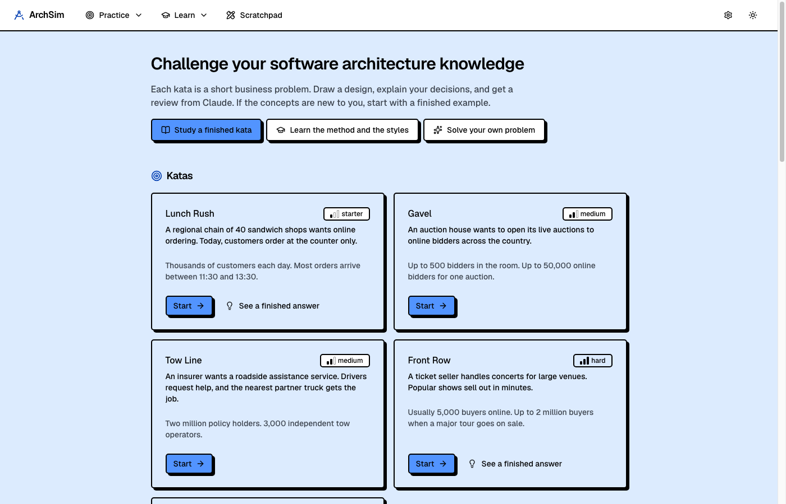
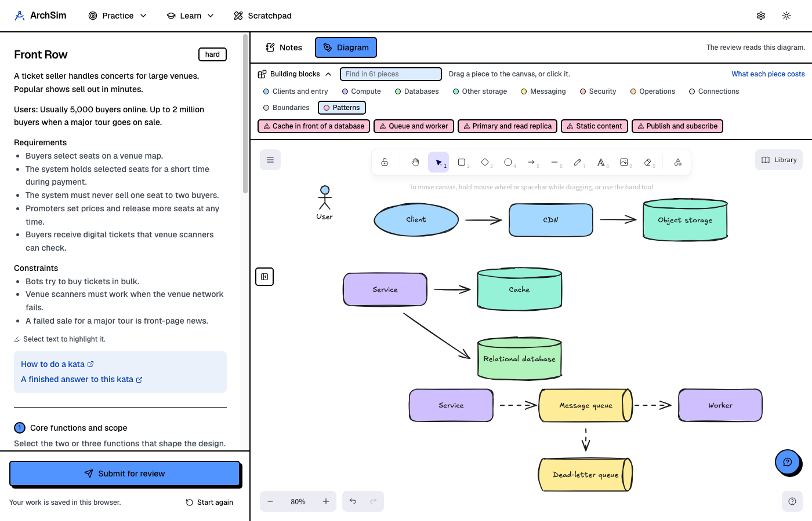
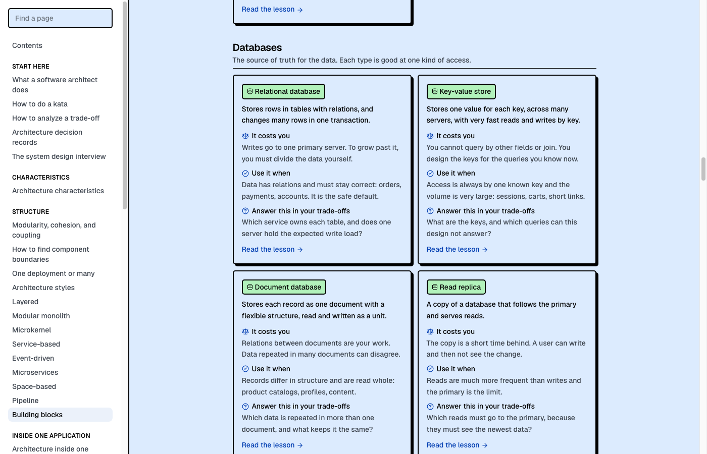
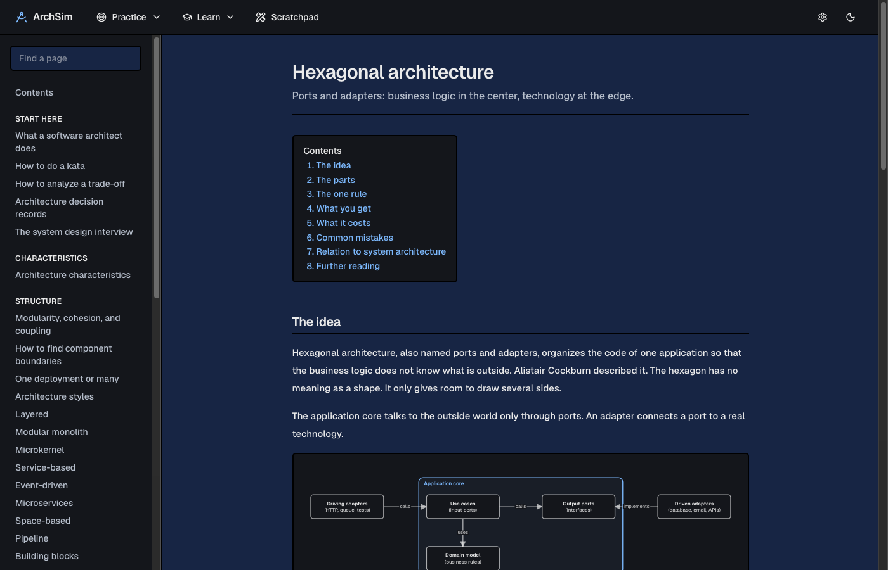
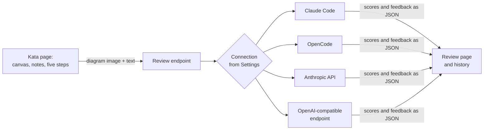
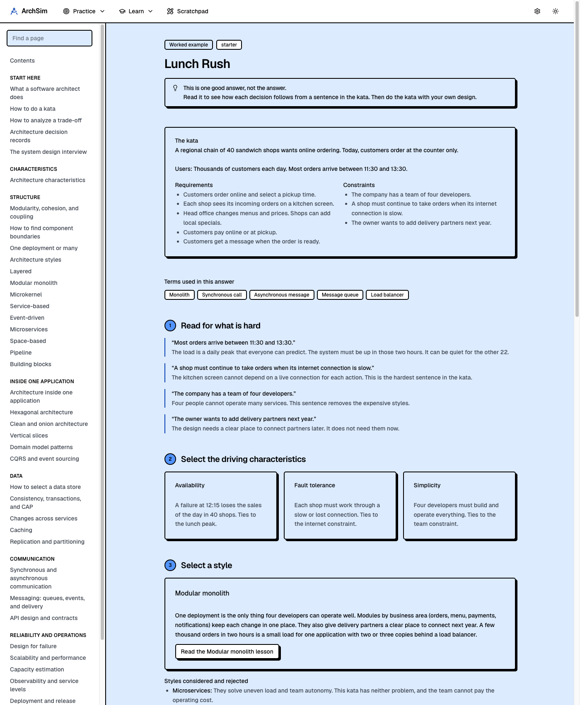

# ArchSim

**Challenge your software architecture knowledge, with an AI reviewer that grades your reasoning.**

Website: [aesbetancourt.dev/archsim](https://aesbetancourt.dev/archsim/)

AI tools now write a large part of the code. The decisions that stay with people are the expensive ones: how a system is divided, where its data lives, how its parts talk, and which qualities it must have. Those decisions are architecture, and they are hard to practice. You can attempt a design alone, but nobody tells you where your reasoning is weak.

ArchSim closes that gap. You take a short business problem, draw a design, explain your trade-offs, and get a structured review in about a minute.



## What you do in it

1. **Pick a kata.** A kata is a short problem: a sandwich chain that wants online orders, a ticket seller that must survive two million buyers, a payment system that must never charge twice.
2. **Think.** Highlight the sentences that matter and write in a private notepad, as you would with pen and paper.
3. **Follow five steps.** Set the scope, select the three driving characteristics, select an architecture style, draw the diagram, and write the trade-offs.
4. **Get a review.** The reviewer reads your diagram and your text. It scores seven dimensions from 1 to 5, quotes the evidence for each score, names the top risk, and asks the questions a review board would ask.

There is no single correct answer to a kata. The reviewer grades the quality of your reasoning against the problem, not a match with a reference design.



## Features

### Practice

- **Katas and interview questions.** Original katas from starter to hard, classic system design interview questions (link shortener, chat, news feed, video streaming, notifications, payments), and two open interview prompts.
- **A drawing canvas.** An embedded [Excalidraw](https://excalidraw.com) canvas, the same kind of tool used in real interviews.
- **Building blocks.** A palette above the canvas with 48 standard components in seven groups, three kinds of connection, five boundaries, and five small patterns. Stored data is a cylinder and a message channel is a pipe, as in the usual notation. Drag a piece to the canvas. A Learn page says what each piece costs you.
- **Auto-save.** Your answers, notes, and diagram for each kata are saved in the browser as you work. The home page lists the katas in progress.
- **A tutor chat.** A help chat sits next to the canvas. In a kata it explains concepts, gives hints, and asks about the pieces you used. It does not hand you the design.
- **Solve a problem.** Paste any problem text, for example an interview question you had. The app writes a worked answer with the five-step method and adds the problem to your katas.
- **The Architectural Katas collection.** The app reads Ted Neward's public kata collection, so you can practice on about 40 more problems.
- **Scratchpad.** Free boards for designs that are not katas. Each board has the full canvas with the building blocks and the same notepad as a kata, and it is saved automatically.



### Learn

- **A wiki of 43 pages** on the knowledge areas of a senior architect: trade-off analysis, modularity, architecture styles, data and consistency, messaging, resilience, observability, security, evolution, and the work with teams.
- **Design inside one application.** Hexagonal, clean, and onion architecture, vertical slices, domain model patterns, CQRS, and event sourcing, with a clear line between system architecture and application architecture.
- **Worked examples.** Finished katas that show each decision and the sentence in the problem that caused it, with a diagram, the rejected options, and a different valid answer.
- **A glossary** of more than 120 terms in plain words, each with an example and a link to a lesson and to Wikipedia.



## Works with several AI providers

The reviewer, the tutor chat, and the worked answers all use one connection that you select in Settings. No provider is required by the design.

| Mode | What it uses | API key in the app |
|---|---|---|
| Claude Code | The `claude` command and its login on your computer | No |
| OpenCode | The `opencode` command and its login on your computer | No |
| Anthropic API | An Anthropic API key | Yes |
| OpenAI-compatible endpoint | Google Gemini, OpenRouter, OpenAI, a local Ollama model, or any provider with this API format | Yes, except for local models |

Each review records which model wrote it, so scores from different models stay distinguishable. A review needs a model that can read images and return structured JSON.

## Run it

You need Node.js 20.9 or later, pnpm, and one of the four connections above.

```bash
pnpm install
pnpm dev
```

Open [http://localhost:3000](http://localhost:3000). The default connection is Claude Code. To use a different one, open Settings with the gear icon.

This project uses pnpm only. An install with npm, Yarn, or Bun stops with an error.

## How it is built

- **Next.js** (App Router) and **TypeScript**
- **Tailwind CSS** with the [neobrutalism](https://www.neobrutalism.dev) component set, on Base UI
- **Excalidraw** for the canvas and **Tiptap** for the notes
- **No database.** Attempts, boards, settings, and your own problems are plain files in a `data/` folder that git ignores. Highlights and notes in progress are in the browser.



The reviewer has read-only access. In the two command-line modes, the app starts the tool in the folder of one attempt, with file edits and shell commands turned off.

## Things to know

- **It is a local, single-user tool.** There is no login and no hosted version. Your data stays on your computer, except for what a review sends to the model provider you selected.
- **The lessons and worked examples are written with AI and are not reviewed by an expert.** Treat each one as a reasoned answer, not as an authority. The reading list in the app points to the books that are.
- **Scores are a guide.** They are useful to compare your own attempts over time, with the same model.

## Credits

- **The architecture kata** is an idea of [Ted Neward](https://github.com/tedneward/ArchKatas). The app reads his public collection of katas and shows each kata with its author. The kata texts are not part of this repository.
- **The method** is inspired by the book *Fundamentals of Software Architecture* by Mark Richards and Neal Ford: architecture characteristics, architecture styles, and the rule that every decision is a trade-off.

## License

[MIT](LICENSE). You can use, copy, and change this code. Keep the copyright notice.

ArchSim is a personal project. It is not affiliated with the authors above or with any AI provider.


