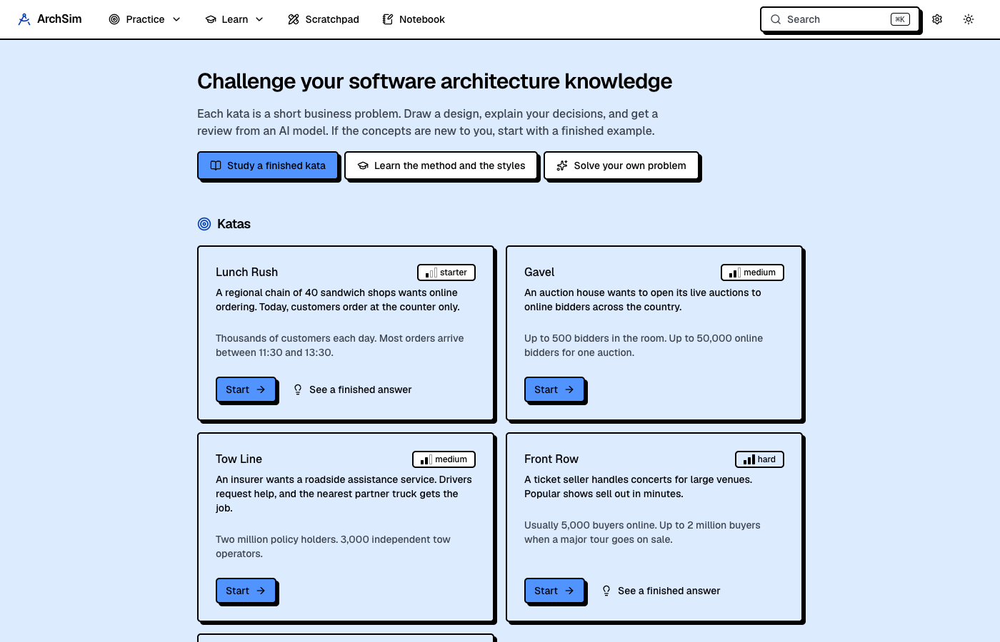
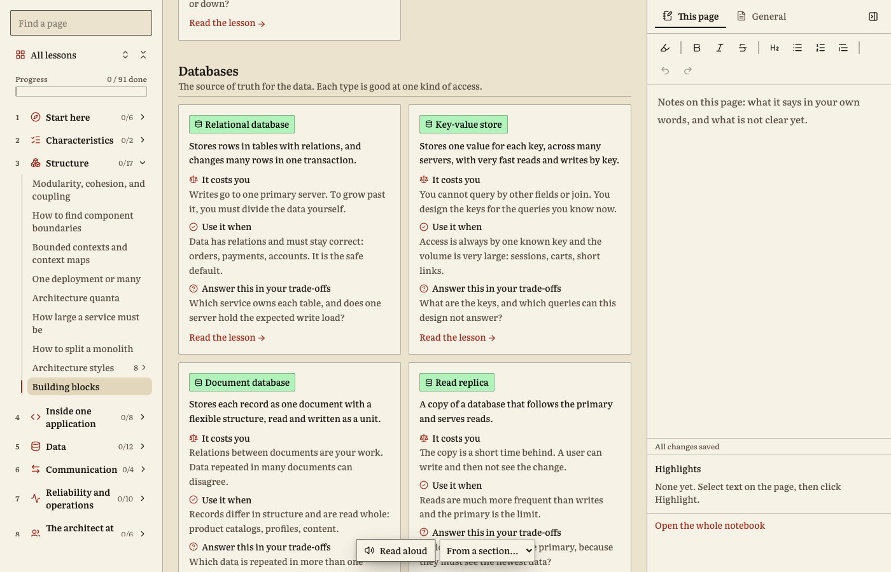
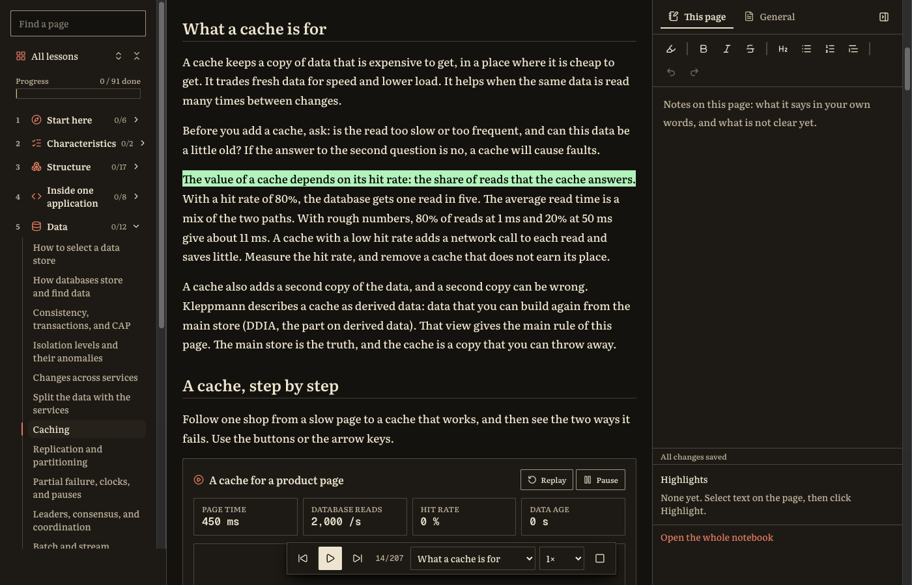
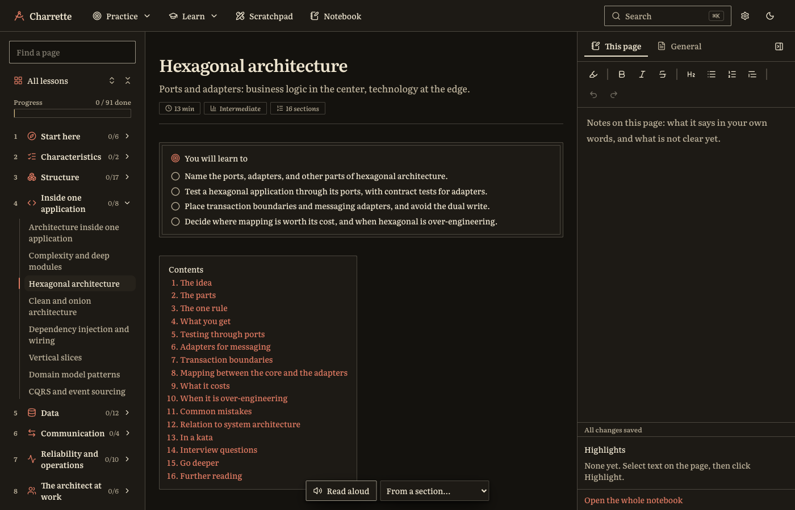
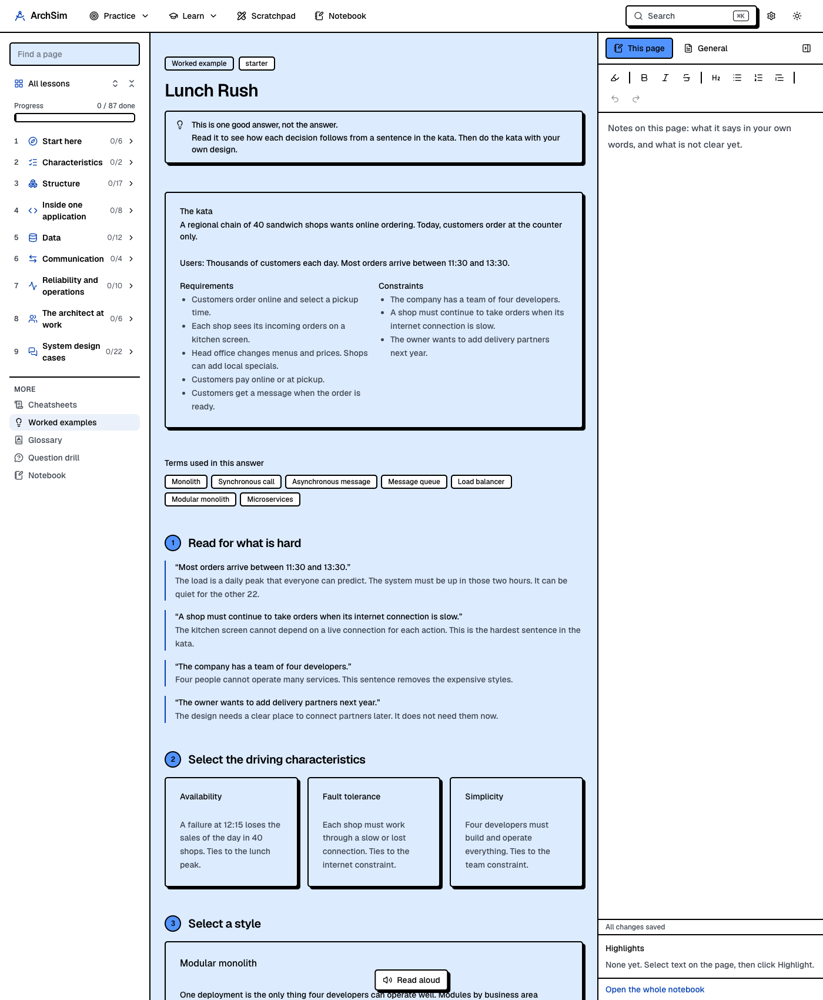
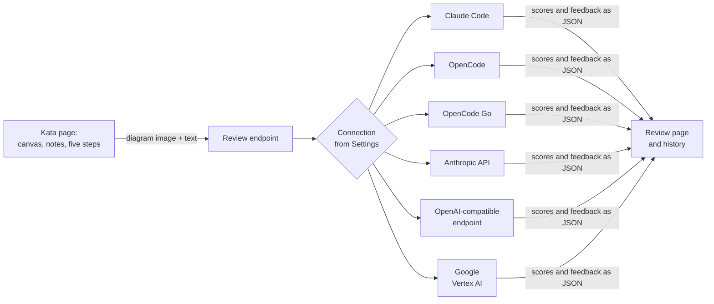

# Charrette

**Draw it. Defend it. Face the crit.**

Practice software architecture with katas, and get your reasoning reviewed by an AI critic.

Website: [aesbetancourt.dev/charrette](https://aesbetancourt.dev/charrette/)

AI tools now write a large part of the code. The decisions that stay with people are the expensive ones: how a system is divided, where its data lives, how its parts talk, and which qualities it must have. Those decisions are architecture, and they are hard to practice. You can attempt a design alone, but nobody tells you where your reasoning is weak.

Charrette closes that gap. You take a short business problem, draw a design, explain your trade-offs, and get a structured review in about a minute.



### Why the name

A charrette (said "sha-RET") is a short, intense design session that ends in a critique. The word is French for "cart". The best-known story comes from 19th-century Paris: architecture students at the École des Beaux-Arts worked on their drawings until a cart came to collect them at the deadline. Each kata here is the same ritual: draw a design against a problem, defend your trade-offs, and face the crit.

## What you do in it

1. **Pick a kata.** A kata is a short problem: a sandwich chain that wants online orders, a ticket seller that must survive two million buyers, a payment system that must never charge twice.
2. **Think.** Highlight the sentences that matter and write in a private notepad, as you would with pen and paper.
3. **Follow five steps.**
   1. Set the scope. Name the few functions that shape the design, and what you leave out.
   2. Select the characteristics. Pick the qualities that drive this problem, usually three, and tie each one to the text.
   3. Select a style. Choose the simplest architecture style that supports them.
   4. Draw the diagram.
   5. State the trade-offs. Say what your design gives up, and where it fails first.
4. **Get a review.** The reviewer reads your diagram and your text. It scores seven dimensions from 1 to 5 and quotes the evidence for each score from your own work. For each dimension it explains the idea, gives an example, and points to a lesson to read. It also names the top risk and asks the questions a review board would ask.

There is no single correct answer to a kata. The reviewer grades the quality of your reasoning against the problem, not a match with a reference design.


## Features

### Practice

- **Katas and interview questions.** Five original katas from starter to hard, and 18 interview questions. They include the classic system design questions (link shortener, chat, news feed, video streaming, notifications, payments), AI systems (agent triggers, a voice support agent, insights from sales calls), and open interview prompts.
- **Practice under time.** A clock in the kata panel copies the time box of an interview: 20, 30, 45, or 60 minutes. It shows the phase that an interviewer expects now: clarify by minute 5, a first design from end to end by minute 15, then deep dives, then the wrap-up. A soft tone marks the end of each phase.
- **A drawing canvas.** An embedded [Excalidraw](https://excalidraw.com) canvas, the same kind of tool used in real interviews.
- **Building blocks.** A palette above the canvas with 48 standard components in seven groups, three kinds of connection, five boundaries, and five small patterns. Stored data is a cylinder and a message channel is a pipe, as in the usual notation. Drag a piece to the canvas. A Learn page says what each piece costs you.
- **Auto-save.** Your answers, notes, and diagram for each kata are saved in the browser as you work. The home page lists the katas in progress. To start a kata again, remove it from that list. The app keeps your reviewed attempts and your highlights. Kata highlights go to the notebook.
- **A tutor chat.** A help chat sits next to the canvas. In a kata it explains concepts, gives hints, and asks about the pieces you used. It does not hand you the design.
- **Solve a problem.** Paste any problem text, for example an interview question you had. The app writes a worked answer with the five-step method and adds the problem to your katas.
- **The Architectural Katas collection.** The app reads Ted Neward's public kata collection, so you can practice on about 40 more problems.
- **Scratchpad.** Free boards for designs that are not katas. Each board has the full canvas with the building blocks and the same notepad as a kata, and it is saved automatically.



### Learn

- **96 lessons in eleven sections** on the knowledge areas of a senior architect: trade-off analysis, characteristics, structure and styles, data and consistency, communication, reliability and operations, the work with teams, product decisions, and AI systems. Each lesson has a level, a reading time, and objectives.
- **A course sidebar.** The sections are numbered in reading order. The sidebar shows your progress in each section and has a filter to find a page. The notebook sits on the other side of the lesson.
- **Design inside one application.** Hexagonal, clean, and onion architecture, vertical slices, domain model patterns, CQRS, and event sourcing, with a clear line between system architecture and application architecture.
- **Product and decisions.** Four lessons for architects who work with product, and for technical product roles: how decisions are made (one-way and two-way doors, DACI, RAPID, disagree and commit), the RACI matrix, prioritization (MoSCoW, RICE, cost of delay, the Kano model, technical debt against features), and product thinking (outcomes, OKRs, discovery, metrics, product sense).
- **AI systems.** Five lessons on systems that use a language model: the model as one part of the system (rules in code, structured output, a port for the model), agents and tools (state machines, guards, handoff to a person), evaluation (test sets, code checks, LLM-as-judge, simulated users), cost and latency (token estimates, latency budgets, batch or per event), and voice agents (the speech pipeline, turn-taking, the latency budget, cost per minute).
- **22 system design cases**, each a short case study of a known type of system.
- **Walkthroughs.** Some lessons explain one diagram in steps, for example a cache that fails and a saga that compensates. Use the buttons or the arrow keys.
- **Worked examples.** Ten finished katas that show each decision and the sentence in the problem that caused it, with a diagram, the rejected options, and a different valid answer.
- **Cheatsheets.** One page for each section, with a filter.
- **A glossary** of 347 terms in plain words, each with an example and a link to a lesson and to Wikipedia.

### Study

- **A guide to the app.** The Guide page shows how to use Charrette. It explains a first session, the practice loop, and the study loop. It gives a normal week and a four-week plan for interview preparation. It also lists the keyboard shortcuts and where the app saves your work. Open it with the help icon in the top bar.
- **Search.** Press Cmd+K or Ctrl+K on any page. It finds lessons, sections, cases, katas, terms, cheatsheets, interview questions, and your notes.
- **Highlights and the notebook.** Select text in a lesson to highlight it and add a note. The sidebar of a lesson has tabs for the page notes, the highlights, the bookmarks, and the general notes. Click Expand to see them in a large panel over the lesson. The Notebook page lists your work by lesson: each lesson is a closed row with counts, and a filter finds a lesson by its title. A general note opens on its own page with a full-size editor.
- **Bookmarks.** Click the bookmark next to a lesson title or a section heading to find that place again. The sidebar and the Notebook page list your bookmarks, with a link to each one.
- **Insights.** On the Notebook page, click **Create insights**. The model reads all your bookmarks (with the text of each section), highlights, and notes, and writes a study document: the big picture, the key ideas, how they connect, what your notes add, the gaps to check, and review questions. The model is the one you select in Settings. The work runs in the background on the server, so you can reload or leave the page. The document shows in the general notes when it is ready, and you can edit it. Click again after you add or remove marks to get a new one.
- **Progress.** Mark a lesson as done. The sidebar shows how many lessons are done in each section.
- **Read aloud.** A player reads the lesson and highlights the sentence that it reads, so your eyes can follow the voice. Press Alt+R to start or pause. To start at a place, point at a paragraph and click the play button on its left, or pick a section in the player. While the player is open, click any sentence or a link in the contents to move the reading there. It skips code, diagrams, tables, diagram legends, and text in parentheses. It pauses a moment before each heading and each list item. You can change the speed from 0.75× to 2×. The player uses the voices of your browser, or Google Cloud voices that you select in Settings (see [Read aloud with Google voices](#read-aloud-with-google-voices)).



### Interview practice

- **Question drill.** 472 interview questions from 91 lessons, 28 of them behavioral. Write your answer, and the model grades it against the lesson. Filter by section or by the lessons you finished.
- **Product drill.** 18 product cases that interviewers ask engineers: what a feature costs, how you prove that it works, who pays, what comes first, and when the user gets the result. Start with a number or a position. The model does your arithmetic again and grades the answer.
- **Vocabulary drill.** Explain the glossary terms in your own words. Spaced repetition brings back the terms you missed. An optional AI check says what your explanation covers and what it misses.
- **Behavioral interviews and the story bank.** A lesson on behavioral interviews, and a story bank in the notebook. Write true work stories in the STAR form and tag each one with competencies. The bank shows which of the 11 competencies have no story yet. In the drill, a behavioral answer can start from a saved story, and the model grades it as a story.





## Works with several AI providers

The reviewer, the tutor chat, and the worked answers all use one connection that you select in Settings. No provider is required by the design.

| Mode                       | What it uses                                                                                                                        | API key in the app           |
| -------------------------- | ----------------------------------------------------------------------------------------------------------------------------------- | ---------------------------- |
| Claude Code                | The `claude` command and its login on your computer                                                                                 | No                           |
| OpenCode                   | The `opencode` command and its login on your computer                                                                               | No                           |
| OpenCode Go                | An OpenCode Go API key                                                                                                              | Yes                          |
| Anthropic API              | An Anthropic API key                                                                                                                | Yes                          |
| OpenAI-compatible endpoint | Google Gemini, OpenRouter, OpenAI, a local Ollama model, or any provider with this API format                                       | Yes, except for local models |
| Google Vertex AI           | Gemini models, or Claude models enabled in the Model Garden, in your Google Cloud project, with the `gcloud` login on your computer | No                           |

Each review records which model wrote it, so scores from different models stay distinguishable. A review needs a model that can read images and return structured JSON.

## Run it

You need Node.js 20.9 or later, pnpm, and one of the connections above.

```bash
git clone https://github.com/aesbetancourt/charrette.git
cd charrette
pnpm install
pnpm dev
```

Open [http://localhost:3000](http://localhost:3000). The default connection is Claude Code. To use a different one, open Settings with the gear icon.

### Use Google Vertex AI

Vertex AI uses the same Google Cloud login as the Google voices, so it needs no API key:

1. Turn on the Vertex AI API in a Google Cloud project.
2. Run `gcloud auth application-default login` one time on your computer.
3. In Settings, select **Google Vertex AI**. Enter the project ID, or leave it empty to use the project of the Google voices, then the quota project of your login.
4. Select a model in the list. The app asks Vertex AI which models your project and location have. Gemini and Claude are in separate groups, and **Other model…** takes any model ID. Then click **Save and test the connection**.

A Claude model on Vertex AI, such as `claude-sonnet-5-5`, must first be enabled in the Model Garden of the project, and can need a region such as `us-east5`. Google bills the project for each call.

### Read aloud with Google voices

Read aloud works without setup, with the voices of your browser. For the more natural Google Cloud Chirp 3: HD voices:

1. Turn on the Text-to-Speech API in a Google Cloud project.
2. Run `gcloud auth application-default login` one time on your computer.
3. In Settings, under Read aloud, select **Google Cloud voice**. Enter the project ID, or leave it empty to use the quota project of your login.
4. Select a voice, then click **Save and play a sample**.

Google bills the characters that it reads. At the time of writing, the price is about $30 for one million characters, after a free allowance each month. All the lessons together are about 1.2 million characters. The app saves the audio of each sentence in `data/speech`, so a sentence costs money only the first time that you hear it with a voice. If the Google voice fails, the player continues with the browser voice.

This project uses pnpm only. An install with npm, Yarn, or Bun stops with an error.

## How it is built

- **Next.js** (App Router) and **TypeScript**
- **Tailwind CSS** with the [neobrutalism](https://www.neobrutalism.dev) component set, on Base UI
- **Excalidraw** for the canvas and **Tiptap** for the notes
- **TanStack Query** for the data that the browser loads from the server: the lesson progress, the bookmarks, the highlights, the notes of a page, the stories, the search index, and the state of the insights job. Lists that only show stay in a cache. Text that you change loads again at each visit, so an editor never starts with an old copy. It sends each request also when the browser is offline, because the server is on your computer. All requests are in one file, `src/lib/browser/api.ts`, and a lint rule stops a `fetch` call in a component
- **es-toolkit** for small helpers, such as the delay of the autosaves (`src/lib/browser/use-autosave.ts`)
- **Google Cloud Text-to-Speech** (optional) for the read-aloud voices, with the browser Web Speech API as the default
- **Oxlint** and **Oxfmt** from [Oxc](https://oxc.rs) for lint and format (`pnpm lint`, `pnpm fmt`). The lint stops nested ternaries and numbers without a name, and the type check stops a link to a page that does not exist. Use [Knip](https://knip.dev) for unused files, exports, and dependencies (`pnpm knip`)
- **No database.** Attempts, boards, the notebook, lesson progress, settings, your own problems, and the read-aloud audio are plain files in a `data/` folder that git ignores. Kata answers and notes in progress, and the drill progress, are in the browser.



### Where the code is

```text
content/        the lessons, cheatsheets, guide, and product cases, as Markdown and JSON
src/app/        the pages, and the API routes in src/app/api
src/components/ the parts of the screen. ui/ has the base controls, and settings/ has the
                cards of the Settings page
src/lib/        the logic, in four folders, with small shared helpers at its root
  content/      what the app teaches: katas, lessons, glossary, building blocks
  store/        your work, saved as files in data/
  ai/           the connection to the model, and the form of each answer
  browser/      code that needs the browser: saved drafts, drill progress, the clock,
                the text of the page, and the voice of the read-aloud player
src/prompts/    every word that the app sends to a model. See src/prompts/README.md
tests/          the unit tests, in the same folders as src/. Run them with pnpm test
data/           your work on this computer. Git ignores it
docs/           the website
```

To change how the model reviews, grades, or answers, change a file in `src/prompts/`. The form of each answer is a schema in `src/lib/ai/`, next to the code that reads it.

The reviewer has read-only access. In the two command-line modes, the app starts the tool in the folder of one attempt, with file edits and shell commands turned off.

## Things to know

- **It is a local, single-user tool.** There is no login and no hosted version. Your data stays on your computer, except for what you send to the model provider you selected. With Google voices, the lesson text also goes to Google Cloud. With Vertex AI, your diagram and text go to your Google Cloud project.
- **The lessons and worked examples are written with AI and are not reviewed by an expert.** Treat each one as a reasoned answer, not as an authority. The reading list in the app points to the books that are.
- **Scores are a guide.** They are useful to compare your own attempts over time, with the same model.

## Credits

- **The architecture kata** is an idea of [Ted Neward](https://github.com/tedneward/ArchKatas). The app reads his public collection of katas and shows each kata with its author. The kata texts are not part of this repository.
- **The method** is inspired by the book _Fundamentals of Software Architecture_ by Mark Richards and Neal Ford: architecture characteristics, architecture styles, and the rule that every decision is a trade-off.
- **The engraving** on the website is by Alexis Lemaistre, 1889, from _L'École des Beaux-Arts dessinée et racontée par un élève_. It comes from [Wikimedia Commons](https://commons.wikimedia.org/wiki/File:Charrette,_%C3%89cole_nationale_sup%C3%A9rieure_des_beaux-arts,_by_Alexis_Lemaistre.png) under [CC BY-SA 4.0](https://creativecommons.org/licenses/by-sa/4.0/). The copy in `docs/images` is converted to JPEG and made smaller, and it stays under CC BY-SA 4.0. The license of this repository does not apply to it.

## License

[PolyForm Noncommercial 1.0.0](LICENSE). Charrette is source available, not open source:

- **You can** use, copy, and change it for any noncommercial purpose: personal study, interview preparation, hobby projects, research, and teaching. Schools, charities, public research, and government can use it too.
- **You cannot** use it for a commercial purpose without a separate license. For example, you cannot sell it, offer it as a paid service, or use it inside a company for its business.
- **Keep the notice.** A copy that you give to someone must include the license and the line that starts with `Required Notice:`.

For a commercial license, open an issue on GitHub.

Versions published before 2026-11-19 are under the MIT license. That license still applies to those copies.

### Other people's work

The license of this repository covers only the work of its author. Other work keeps its own terms:

- **The packages** that the app installs keep their own licenses. All of them are permissive (MIT, ISC, Apache 2.0, BSD, and similar), so they allow this use. The repository does not include their code.
- **The Architectural Katas** of Ted Neward are not in this repository. The app reads them from GitHub when you open the collection, and shows each one with its author.
- **The ideas** in the lessons come from the books and articles that each lesson names. The lessons explain these ideas in their own words. Short quotes name their source.
- **The engraving** stays under CC BY-SA 4.0, as the credits say.
- **The fonts** Literata and Geist are under the SIL Open Font License.

Charrette is a personal project. It is not affiliated with the authors above or with any AI provider.
